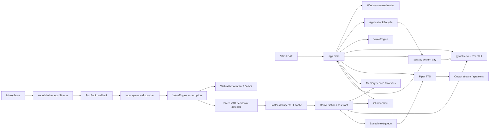
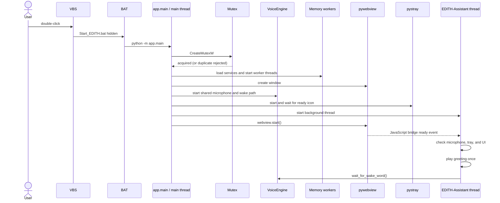
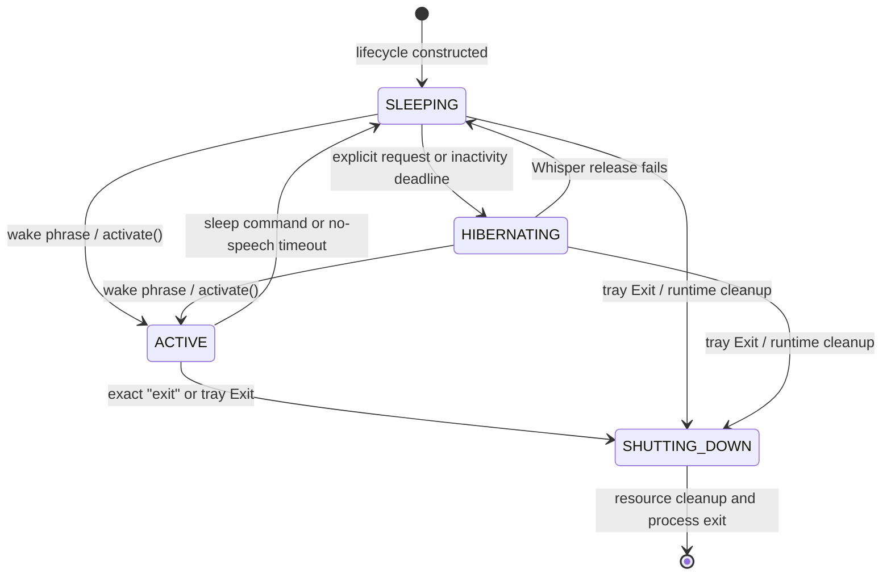
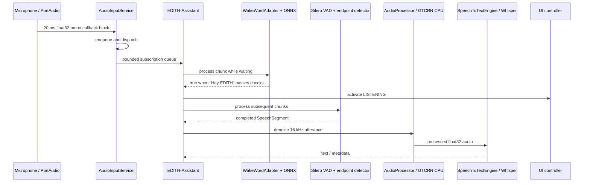
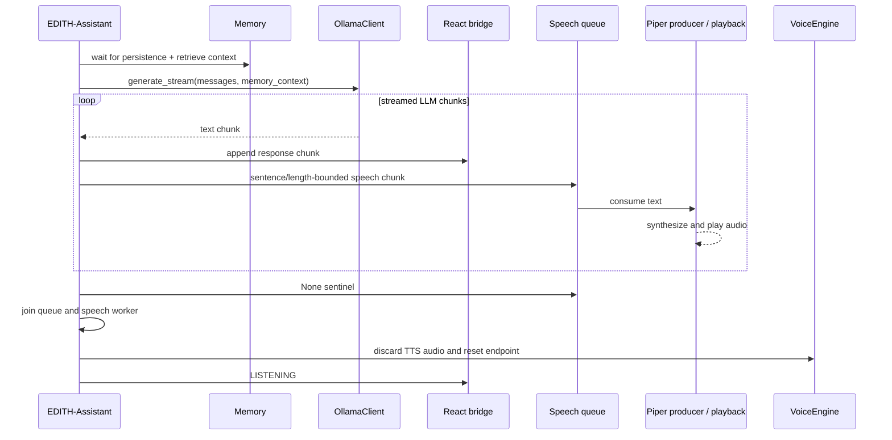

# EDITH Background Presence and Lifecycle — Technical Implementation Report

> **Audience:** EDITH developers who know basic Python and want to understand,
> maintain, and safely extend its background-presence implementation.
>
> **Accuracy rule:** This report describes the checked-out source and test
> evidence reviewed for this report. Source code is authoritative when an older
> guide differs. A statement that a test was reported by a developer is not the
> same as an independently observed test result.

## Table of contents

1. [EDITH overview](#1-edith-overview)
2. [Technology stack](#2-technology-stack)
3. [Complete project architecture](#3-complete-project-architecture)
4. [Application startup](#4-application-startup)
5. [Lifecycle state machine](#5-lifecycle-state-machine)
6. [Sleep versus hibernation](#6-sleep-versus-hibernation)
7. [Wake word and audio pipeline](#7-wake-word-and-audio-pipeline)
8. [LLM and TTS pipeline](#8-llm-and-tts-pipeline)
9. [Windows system tray](#9-windows-system-tray)
10. [Startup greeting](#10-startup-greeting)
11. [Commands](#11-commands)
12. [Threading and resource management](#12-threading-and-resource-management)
13. [Single-instance protection](#13-single-instance-protection)
14. [File-by-file implementation guide](#14-file-by-file-implementation-guide)
15. [Configuration](#15-configuration)
16. [Testing and validation](#16-testing-and-validation)
17. [Known limitations](#17-known-limitations)
18. [Developer maintenance guide](#18-developer-maintenance-guide)
19. [Future development](#19-future-development)
20. [Complete execution flow](#20-complete-execution-flow)
21. [Glossary](#21-glossary)

---

## 1. EDITH overview

EDITH is a Windows desktop voice assistant. Python owns the assistant runtime:
audio capture, wake-word detection, speech recognition, command routing,
conversation and memory work, local-model requests, and speech synthesis. A
React interface hosted by pywebview is the visual overlay; it is not the owner
of the voice lifecycle.

**Background presence** means that hiding the overlay or putting EDITH to
sleep does not close the process. One microphone stream and the wake-word
monitor continue running so a later “Hey EDITH” can reactivate the interface.
The Windows tray gives the otherwise-hidden process a persistent place to
show its status and provide controls.

Lifecycle management was introduced to separate three things which can look
similar to a user but have different meanings in code:

1. The visible UI can be shown or hidden.
2. The assistant can be waiting for a wake phrase or handling a conversation.
3. The application process can be shutting down.

In particular, hiding the overlay is not process termination. The hibernation
path releases the cached Whisper model while retaining the audio and wake
path. It does not unload every model or shut down the application.

### Earlier architecture and lifecycle additions

| Existing subsystem | Lifecycle/background-presence addition |
|---|---|
| React UI in pywebview | Hide-on-close and explicit show/hide methods, without tying visibility to process lifetime |
| Voice engine with microphone, wake detection, VAD and STT | Sleep/hibernate orchestration that leaves the single audio stream and wake detector active |
| Piper and Ollama integration | Startup greeting and a shared shutdown route; no replacement of the TTS models or Ollama transport |
| Existing conversation and SQLite memory | Background-presence lifecycle does not replace the memory model |
| Windows BAT launcher | Visible mode remains available; hidden mode can log under the user's local application data |
| No persistent status affordance | A pystray icon, status tooltip, and menu are added |
| Existing startup flow | A Windows named mutex rejects a second instance; a readiness-gated greeting runs once per application process |

The lifecycle is an orchestration layer around existing components. It is not
a Windows service, and it does not install itself to run at user logon.

## 2. Technology stack

The versions below were observed in the project's active `.venv` during
verification. They are **environment observations**, not a lockfile or a
promise that every machine has the same versions. The root
[requirements.txt](../requirements.txt) only declares the added tray packages;
it is not a complete install manifest for the entire application.
The checked `.venv` also has sherpa-onnx 2.0.3 installed for GTCRN; that
package is not declared in the root requirements file, so a fresh
environment must install it separately to enable denoising.

| Technology | What it is and EDITH's use | Communication boundary |
|---|---|---|
| Python 3.13.2 and `.venv` | Runs the assistant and isolates Python packages for this checkout. Launchers use `.venv\Scripts\python.exe`. | `Start_EDITH.bat` invokes `python -m app.main` from the repository root. |
| pywebview 6.2.1 / WebView2 | Hosts the existing React build in a native Windows window. EDITH uses the Edge/WebView2 renderer for its transparent overlay. | Python calls window methods and `evaluate_js`; the React bridge exposes named functions on `window`. |
| React 18 / Vite | Builds the visual UI and its bridge. Vite's production output is loaded from `edith-ui\dist\index.html`. | The JavaScript bridge receives state and response updates from Python. |
| sounddevice 0.5.6 / PortAudio | Opens the one persistent mono input stream and Piper's output stream. | The PortAudio input callback copies microphone blocks into a bounded Python queue; Piper writes output through a sounddevice output stream. |
| NumPy 2.5.3 | Represents, converts, buffers, and validates audio samples. | Arrays are passed from audio capture through the wake/VAD/STT code. |
| openWakeWord feature utilities and ONNX Runtime 1.30.0 | EDITH's frozen wake-word assets are ONNX models. `WakeWordDetector` uses ONNX Runtime and openWakeWord's `AudioFeatures`. | `WakeWordAdapter` converts shared float32 chunks to int16 and feeds the existing detector. The detector's ONNX session uses the CPU execution provider. |
| Silero VAD 6.2.3 and PyTorch 2.14.0 | VAD estimates whether incoming frames contain speech. | The endpoint detector sends 512-sample frames at 16 kHz to the Silero wrapper; the wrapper converts each frame to a torch tensor. |
| sherpa-onnx 2.0.3 / GTCRN | Optionally denoises completed 16 kHz utterances. | `AudioProcessor` uses the lazily loaded GTCRN model on CPU; unavailable or failing model setup falls back to raw audio. |
| Faster-Whisper 1.2.1 / CTranslate2 | Converts completed speech segments into text. | `VoiceEngine.listen()` passes a completed waveform through GTCRN and then `SpeechToTextEngine`; that engine explicitly requests `small`, CPU/int8, six CPU threads, and a lazy model cache. It does not use GPU selection on the active voice path. |
| Ollama HTTP API | Runs the configured local chat model in the separate Ollama server process. | `OllamaClient` uses Python's `urllib` to call `/api/tags` and streaming `/api/chat`; no `ollama` Python package was installed in the checked environment. |
| Piper TTS 1.8.0 | Produces EDITH's spoken English or Hindi response using the existing local voice models. | The assistant queues text; Piper produces audio chunks, which are written to the output stream. The current paths are defined in `TextToSpeech`: `D:\Edith\en_US-lessac-medium.onnx` and `D:\Edith\models\tts\hindi\hi_IN-priyamvada-medium.onnx`. |
| SQLite (`sqlite3`) | Stores conversation messages, embeddings, and structured memories. | Memory services use short-lived SQLite connections through `app.memory.database`. |
| pystray 0.19.5 and Pillow 12.3.0 | pystray registers the Windows notification-area icon; Pillow loads the `.ico` image. | Menu callbacks call the supplied UI or centralized shutdown callbacks. |
| BAT and Windows Script Host / VBS | Provide visible and hidden launch paths. | The VBS launches the BAT hidden and asynchronously; the BAT starts the Python module. |

### Important model identity distinction

The source default is `OLLAMA_MODEL=edith:latest`. An environment variable can
select another Ollama tag. The Python source does not prove which base model a
tag resolves to, so it is not safe to claim that the checked source directly
loads Qwen. If `edith:latest` is a Qwen-derived Ollama model in a particular
installation, Qwen inference is being served by Ollama behind this HTTP
boundary. Confirm the tag with the local Ollama installation, not by inference
from the Python class name.

## 3. Complete project architecture

### Component responsibilities

| Component | Responsibility |
|---|---|
| `app.main` | Constructs services, starts the UI/tray/voice lifecycle, routes commands, streams responses, and coordinates shutdown. |
| `app.core.lifecycle` | Stores the application mode, monitors inactivity, requests Whisper-cache release, notifies tray status, and owns the Windows single-instance guard. |
| `app.core.commands` | Normalizes a transcription and checks whether it is one of the exact lifecycle phrases. |
| `app.voice_v2.engine` | Orchestrates the persistent audio subscription, wake wait, VAD/endpointing, transcription, conversation flags, post-TTS cleanup, hibernation, and close. |
| `app.voice_v2.core.audio_input` | Owns one `sounddevice.InputStream`, its callback queue, dispatcher thread, and bounded subscriber queues. |
| `app.voice_v2.integration.wake_word_adapter` | Adapts raw shared float32 chunks to the existing wake detector and gates scored detections with the shared Silero VAD. |
| `app.voice` wake-word module | Loads the existing wake-word ONNX assets and runs score/RMS/cooldown checks. Its standalone stream-reading method is not used by the active `VoiceEngine` path. |
| `app.voice_v2.detection` | Silero VAD and adaptive endpointing produce completed speech segments. |
| `app.voice_v2.processing` | Audio validation/metrics and optional GTCRN denoising before STT. |
| `app.voice_v2.recognition` | CPU/int8 Faster-Whisper transcription, lazy model cache, no-speech filtering, and result formatting. |
| `app.llm.client` | Builds the Ollama request and streams response text. |
| `app.core.assistant` and `app.conversation` | Build memory-informed prompts, retain the current bounded chat history, and queue persistence/extraction. |
| `app.memory` | Loads embeddings, retrieves memories, and persists conversation/structured-memory records in SQLite. |
| `app.memory.workers` | Runs persistence and extraction queues on separate non-daemon threads. |
| `app.voice.tts` | Holds the Piper voices and output stream; consumes text and produces playable audio. |
| `app.ui` | Hosts the overlay, forwards state/response data to React, handles hide/show, and owns the tray integration. |
| `edith-ui` | React components and the JavaScript bridge that render UI state and streamed response text. |

### Architecture diagram



### Complete data flow

The microphone callback does not run ONNX, VAD, STT, or LLM work. It copies a
small block and enqueues it. The audio dispatcher fans that block to the
`VoiceEngine` subscription. While waiting for a wake phrase, the assistant
thread gives chunks to the wake adapter. After detection, that same thread
switches to VAD/endpointing; the resulting speech waveform is transcribed by
Whisper. Exact lifecycle commands are consumed before LLM routing. Ordinary
text goes through the conversation/memory/LLM flow, and streamed LLM chunks
are sent both to the UI and to Piper's text queue.

UI visibility and application mode are separate. A sleeping UI does not imply
that the wake detector, microphone, memory workers, tray, or Python process
have stopped.

### Memory data path

`MemoryService` loads the `all-MiniLM-L6-v2` embedding model and exposes
conversation search plus structured-memory access. Message writes are
handled by the persistence worker: `messages` holds the conversation row and
`memory_vectors` holds its embedding. Structured facts/preferences/projects/
people are extracted by `MemoryManager` through an Ollama request and stored
in `structured_memories`. The database schema and connections are defined in
`app/memory/database.py`; the configured path is relative to the process
working directory (`data/database/edith.db`).

Before a new assistant response, `EdithAssistant.respond_stream()` waits for
message persistence, asks `MemoryService` for relevant context, then builds
the system prompt. Memory extraction is queued separately and may finish
after the current response. The two workers are independent of the
sleep/hibernate mode; this lifecycle does not pause or unload them.

## 4. Application startup

### Launcher sequence

1. The developer double-clicks [start_edith.vbs](../start_edith.vbs).
2. Windows Script Host derives the project folder from the VBS path and starts
   [Start_EDITH.bat](../Start_EDITH.bat) with the `hidden` argument, hidden and
   without waiting for it.
3. The BAT changes working directory to the project root and locates
   `.venv\Scripts\python.exe`.
4. In hidden mode it creates
   `%LOCALAPPDATA%\EDITH\logs\edith.log`, redirects Python output there, and
   launches `python -m app.main`. In visible mode, it runs the same module in a
   console and pauses after exit.
5. `main()` acquires the named mutex before initializing the assistant
   services. A duplicate launch prints/logs that EDITH is already running and
   returns.

### Initialization order in `main()`

After acquiring the mutex, `ExitStack` registers cleanup callbacks as
resources are created. The source order is:

1. `EdithAssistant` and the lightweight `OllamaClient` wrapper.
2. `VoiceEngine` object. Its microphone, wake adapter, VAD, endpoint detector,
   and STT wrapper are initialized when `voice.start()` is called below.
3. `TextToSpeech`, which loads both Piper voices and opens/starts the output
   stream.
4. `MemoryService` (including the sentence-transformer embedding model),
   `MemoryManager`, and `BackgroundMemoryWorker`. The memory worker starts its
   persistence and extraction threads in its constructor.
5. `ConversationService`.
6. `EdithDesktopWindow.create()` and the `EdithUIController`.
7. `ApplicationLifecycle`, configured with the hibernation timeout and
   `voice.hibernate` callback.
8. `EdithSystemTray`, which validates and loads the icon and prepares menu
   callbacks.
9. `voice.start()`. This creates the shared input service and subscription,
   wake adapter, VAD, endpoint detector, and `SpeechToTextEngine`; it starts
   the one microphone stream. Whisper itself remains lazy and is not loaded
   just by constructing the STT manager.
10. `lifecycle.start()` launches its monitor thread; `tray.start()` registers
    the icon and waits up to ten seconds for its setup callback.
11. `llm.is_available()` checks the local Ollama tags endpoint with a
    two-second timeout and prints online/offline status.
12. `EDITH-Assistant` starts as a daemon thread. The calling/main thread then
    enters `webview.start()`, which owns the GUI loop.

The native window is created with `hidden=False`, while the React bridge
initializes its visual state to `SLEEPING` and `visible=false`. Native-window
creation and visible React overlay content are separate conditions.

### Readiness and startup greeting

The desktop's page-load callback starts a helper thread that configures
Windows overlay styles and polls for the required JavaScript bridge functions.
Only after that check does it set the desktop's `_ready` event. Independently,
the tray's setup callback marks its icon visible and sets its readiness event.
The assistant thread checks the microphone, tray, and desktop bridge before
playing the greeting. It then begins wake-word monitoring.



### Thread ownership during startup

The main thread constructs objects and owns the pywebview event loop. The
assistant and service threads are started by their owning objects. The source
does not define explicit `STARTING` or `CLOSED` lifecycle enum values; startup
before the lifecycle controller is constructed and final process teardown
occur outside the `ApplicationMode` state machine.

## 5. Lifecycle state machine

`ApplicationMode` in [app/core/lifecycle.py](../app/core/lifecycle.py)
currently defines **four** values: `ACTIVE`, `SLEEPING`, `HIBERNATING`, and
`SHUTTING_DOWN`. The application brief's terms `STARTING` and `CLOSED` are
useful descriptions of process phases, but are **not implemented enum states**.
The controller is constructed with mode `SLEEPING`; `CLOSED` is reached only
when the process/resources have exited.

| Mode | Meaning | Key active components |
|---|---|---|
| `ACTIVE` | A wake phrase has been detected and EDITH can listen, respond, or continue a conversation. | Microphone, wake detector, VAD/STT, UI, tray, memory workers. Whisper may be loaded after transcription. |
| `SLEEPING` | The assistant is waiting for a wake phrase. The UI is hidden after its sleep animation. | Microphone, wake detector, tray, memory workers, Piper, and memory services remain initialized. A cached Whisper model is not automatically released just by sleeping. |
| `HIBERNATING` | EDITH is still waiting for a wake phrase, but the cached Whisper model has been released. | Same persistent background services as sleeping, except Whisper's cache is empty until a later utterance needs STT. |
| `SHUTTING_DOWN` | Shutdown has been requested; the lifecycle monitor stops and cleanup proceeds. | Cleanup is in progress; the application is not intended to resume. |



### Transition rules and invalid requests

- `activate()` sets `ACTIVE`, resets the inactivity clock, and returns `False`
  if shutdown has already begun.
- `note_interaction()` resets the monotonic inactivity clock unless shutdown
  has begun.
- `sleep()` changes any non-shutdown mode to `SLEEPING`; it does not close the
  microphone or UI process.
- `hibernate_now()` is valid from `SLEEPING`. Calling it from `ACTIVE` raises
  `RuntimeError`; calling it while already hibernating returns `False`.
- A failed hibernation restores `SLEEPING`, logs the error, and re-raises.
  The monitor schedules a retry no sooner than
  `min(60 seconds, configured timeout)`.
- `shutdown()` sets `SHUTTING_DOWN`, signals the condition, and joins the
  monitor thread.
- There is no transition to an implemented `CLOSED` enum value.

The optional `on_mode_change` callback updates the tray tooltip/menu. Callback
exceptions are logged rather than allowed to break the lifecycle transition.
The callback runs while the lifecycle condition is held, so future callbacks
should remain short and avoid waiting for unrelated work.

### Application mode is not the UI state

The React bridge supports `SLEEPING`, `READY`, `LISTENING`, `THINKING`, and
`SPEAKING`. It does not have a `HIBERNATING` UI state. Hibernation is shown in
the tray status; the UI is normally asleep/hidden. `EdithUIController` also
keeps its own UI state. Do not treat these UI labels as `ApplicationMode`.

## 6. Sleep versus hibernation

| Resource/behavior | `SLEEPING` | `HIBERNATING` |
|---|---|---|
| Application process | Continues | Continues |
| UI | Transitions to `SLEEPING`, then hides after 0.55 s | UI is hidden as part of the command/timeout path |
| Tray | Remains running and reports `SLEEPING` | Remains running and reports `HIBERNATING` |
| Microphone stream | Remains running | Remains running |
| Wake-word monitor and ONNX assets | Remain active | Remain active |
| Silero VAD and endpoint detector | Remain initialized | Remain initialized |
| Cached Whisper model | May remain cached if loaded | `SpeechToTextEngine.close()` clears the model-manager cache |
| Piper voice models/output stream | Remain initialized | Remain initialized |
| Memory workers and embedding model | Remain active | Remain active |
| Ollama server model | Not directly changed by sleep | Not directly unloaded by EDITH hibernation; Ollama's per-request `keep_alive` behavior applies |

### Sleeping

Sleeping is primarily a conversation/UI state. A no-speech timeout or exact
sleep command ends the conversation and returns the assistant loop to
`wait_for_wake_word()`. The UI controller sets `SLEEPING` and schedules a
hide after 0.55 seconds to allow the existing fade animation. The `VoiceEngine`
continues using the same audio subscription and microphone stream.

Sleeping does not call `VoiceEngine.hibernate()`. If a Whisper model was
already loaded, the source does not explicitly release it on a normal sleep
transition. If the STT model has not yet been used, it remains unloaded.

### Hibernating

Manual hibernation is ordered as follows in `run_assistant()`:

1. `VoiceEngine.return_to_wake_word_mode()` clears pending audio and resets the
   endpoint and wake adapter.
2. The lifecycle enters `SLEEPING`, and the UI begins hiding.
3. `ApplicationLifecycle.hibernate_now()` changes the mode and calls
   `VoiceEngine.hibernate()`.
4. `VoiceEngine.hibernate()` rejects an active conversation and calls
   `SpeechToTextEngine.close()`.
5. The STT engine delegates to `WhisperModelManager.close()`, which clears its
   model/cache references and runs `gc.collect()`.
6. The outer assistant loop continues to wait on the existing wake-word
   subscription.

Automatic hibernation is monitored only while the lifecycle is `SLEEPING`.
The monitor measures time from the last recorded interaction using
`time.monotonic()`. The next completed utterance calls the existing lazy
`WhisperModelManager.get_model()` path, so Whisper is restored when STT is
actually needed, not merely when the wake phrase is detected.

The implementation does **not** close the wake model, Silero VAD, Piper, the
memory embedding model, or the microphone. Python garbage collection is a
best-effort release of the Whisper Python reference; no source or test result
proves a particular RAM/VRAM amount is returned to the operating system.

### Ollama keep-alive

`OllamaClient` sends the configured `keep_alive` field with chat requests. Its
default is `45s`. Hibernation does not send an unload request to Ollama and
does not modify that setting. Ollama runs in a separate server process and
decides how long its model remains resident after an API request.

## 7. Wake word and audio pipeline

### One stream, multiple processing modes

`VoiceEngine.start()` creates one `AudioInputService` at 16 kHz, mono,
float32, with 20 ms blocks (320 samples). The service's single PortAudio
callback copies each block, marks the array read-only, adds sequence/time
metadata, and places it on a bounded queue. A dispatcher thread distributes
each block to subscribers. When queues fill, old blocks are dropped to favor
low latency instead of building a backlog.

The active `VoiceEngine` path shares this stream for wake detection and speech
capture. `app.voice.wake_word.WakeWordDetector.wait_for_wake_word()` contains
a legacy standalone `sounddevice.InputStream` path; the current
`WakeWordAdapter` integration does not call it. Do not combine the legacy
stream with the active service or that would create a second microphone
stream.

### Wake detection

While the assistant thread calls `wait_for_wake_word()`:

1. Pending audio from the prior turn is discarded.
2. The wake adapter resets the detector's rolling buffer.
3. The assistant thread pulls chunks from the audio subscription.
4. The adapter feeds raw float32 samples to the shared Silero VAD, then
   converts the same un-denoised samples to int16 for the legacy detector.
5. The detector waits for its 2-second rolling window, checks RMS, then runs
   ONNX inference when the adapter's sample check interval has elapsed.
6. A wake score of at least `0.94` must pass two consecutive checks and
   have recent Silero speech evidence (probability at least `0.55` within
   one second); the detector's 2-second cooldown still applies.
7. `lifecycle.activate()` changes the application mode; the UI controller
   shows the overlay and moves it to `LISTENING`.

The wake model files currently referenced by source are
`models/wakeword/hey_edith.onnx`,
`models/wakeword/melspectrogram.onnx`, and
`models/wakeword/embedding_model.onnx`. The model is not changed by the
lifecycle implementation.

### Speech capture, VAD, endpointing, and STT

After wake detection, `VoiceEngine.listen()` consumes the wake flag and marks
the conversation active. The same subscription feeds
`AdaptiveEndpointDetector`; the detector uses Silero probabilities,
hysteresis (start and continuation thresholds), pre-roll, silence duration,
and a maximum utterance duration to build a complete segment. The default
maximum utterance duration in `VoiceEngineConfig` is 600 seconds.

The current endpoint source defaults are in
[endpoint_detector.py](../app/voice_v2/detection/endpoint_detector.py):
0.5-second pre-roll, 0.55 start threshold, 0.35 continuation threshold,
64 ms start confirmation, 1,000 ms short-speech end silence, and 3,500 ms
after sufficient sustained speech. `SpeechToTextEngine.transcribe()` then
passes the utterance through `AudioProcessor` and the CPU GTCRN model
before loading/reusing Faster-Whisper. Processed audio below the
`0.002` RMS silence threshold is skipped. The active STT path requests
CPU/int8 with six threads, beam size 2, temperature 0.0, no
previous-text conditioning, and the prompt
`EDITH, Prayag, Python, Ollama, VS Code.` Segments with
`no_speech_prob >= 0.6` are discarded. `denoise_ms` and `stt_ms` are
logged; the timings include lazy model acquisition on the first request
to each model.



### Preventing EDITH from transcribing its own speech

The microphone continues capturing while Piper plays. After EDITH finishes a
response, `VoiceEngine.prepare_for_next_turn()`:

1. Discards blocks captured during playback.
2. Waits 0.5 seconds for the acoustic tail to settle.
3. Discards blocks captured during that settling period.
4. Resets the endpoint/VAD state.

`return_to_wake_word_mode()` similarly discards pending blocks and resets the
wake and endpoint state before going back to wake detection. These are queue
and detector resets, not full acoustic echo cancellation.

## 8. LLM and TTS pipeline

### Speech to response

The assistant loop receives a transcription dictionary from
`VoiceEngine.listen()`. It checks exact lifecycle commands before calling the
LLM. For ordinary input, it updates the inactivity clock, marks the UI
`THINKING`, creates a text queue, and starts an `EDITH-TTS-Worker`.

`EdithAssistant.respond_stream()` first waits for queued conversation
persistence, gets relevant context through `MemoryService`, records the user
message, and builds the current message list. The history is capped at 20
messages in `ConversationService`. It then consumes
`OllamaClient.generate_stream()` and yields text chunks.

The client:

- Adds EDITH identity, behavior, and memory context as a system message.
- Sends a streaming JSON request to
  `OLLAMA_BASE_URL + "/api/chat"` using `urllib.request`.
- Includes the configured model tag and `keep_alive`.
- Yields each response content fragment as it arrives.

`run_assistant()` prints each LLM fragment, appends it to the UI, and buffers
text for TTS. `extract_speech_chunks()` emits text at sentence boundaries or
splits very long text near a 180-character word boundary. This makes text
visible before the full response is complete and allows speech generation to
start while later LLM chunks are still arriving.

### Text to spoken audio

`speech_worker()` runs `tts.speak_stream(speech_queue)` outside the LLM
generation loop. `TextToSpeech.speak_stream()` starts an
`EDITH-TTS-Producer` thread to synthesize text with the selected Piper voice.
The producer pushes audio into a bounded four-item audio queue; the thread
running `speak_stream()` consumes those chunks and writes them to the
sounddevice output stream.

The assistant puts `None` on the speech queue when response generation is
complete, waits for the queue's unfinished-task count to reach zero, and joins
the speech worker. It then runs `voice.prepare_for_next_turn()` and sets the
UI to `LISTENING` for another utterance in the same conversation.



This is streaming **LLM text and TTS chunking**, not streaming/partial
speech recognition. The user cannot interrupt Piper with a full barge-in path:
the assistant is not simultaneously running a recognition loop while it is
speaking.

## 9. Windows system tray

The tray icon is a separate native notification-area affordance; it is not the
React overlay and does not own the audio or lifecycle state. Windows may show
the icon beside the clock or move it into the hidden-icons (`^`) menu.
The checked pywebview version does not expose a built-in tray API, so this
implementation uses pystray; Pillow loads the icon image.

`EdithSystemTray` in [system_tray.py](../app/ui/system_tray.py):

- Requires the configured icon file to exist and loads it through Pillow.
- Creates one `pystray.Icon` named `EDITH`.
- Uses `run_detached()` so pystray's backend can coexist with pywebview's
  main-thread event loop.
- Marks the icon visible in its setup callback and signals a readiness
  `threading.Event`.
- Uses a lock around its status and start/stop bookkeeping.
- Updates the title to `EDITH - ACTIVE`, `EDITH - SLEEPING`,
  `EDITH - HIBERNATING`, or `EDITH - SHUTTING_DOWN`.
- Calls `update_menu()` after status changes so the dynamic status item is
  refreshed.
- Makes `start()` idempotent and `stop()` idempotent for a single tray
  controller instance.

The current placeholder asset is
[edith_placeholder.ico](../app/ui/assets/edith_placeholder.ico). Replace it
with a valid `.ico` file and set `EDITH_TRAY_ICON_PATH` to its path; no
application code needs to be changed if the file format remains supported.

| Menu item | Callback behavior |
|---|---|
| Open EDITH | Calls `EdithDesktopWindow.show()`. It does not directly set the React state. |
| Hide EDITH | Calls `EdithDesktopWindow.hide()` without shutting down the process. |
| Current status | Displays a notification when the backend supports notifications; otherwise it logs the status. |
| Exit | Calls the same `request_shutdown()` callback used by the voice `exit` command. |

The lifecycle mode observer updates tray status. The icon is not stopped during
sleep or hibernation; `tray.stop()` is registered in the application's
`ExitStack` for shutdown cleanup.
The tooltip reflects the coarse application mode, not the UI's finer
LISTENING/THINKING/SPEAKING state.

**Verified boundary:** automated tests check menu callback wiring, status
updates, visible state, and idempotent start/stop. A Windows backend smoke test
was previously recorded as registering the icon, updating its title across
threads, avoiding a second registration on repeated start, and accepting stop.
That is not a full visual test of every menu item in the complete application.

**Open-action limitation:** the menu's Open callback calls only
`desktop.show()`. The React bridge sets `visible=false` while its state is
`SLEEPING`, so showing the native window while sleeping may not make the
overlay's contents visible. The current unit test only verifies that the
callback is invoked; full user-visible behavior should be checked on Windows.

## 10. Startup greeting

`Settings.STARTUP_GREETING` defaults to “EDITH is online. All systems are
ready.” The assistant thread calls `play_startup_greeting_once()` before
entering `run_assistant()`.

The helper checks, in order:

1. The per-process `greeting_played` event is not already set.
2. `voice.get_stats()` says the microphone is running.
3. The tray reports `is_ready`.
4. The desktop bridge's `_ready` event is set within
   `desktop.BRIDGE_TIMEOUT`.
5. The configured greeting is not empty.

It sets the event and calls the existing `tts.speak(greeting)`. The event is
per application launch, so wake, sleep, and hibernation do not call the
greeting function again. If the greeting is blank, the event is set and
greeting is disabled. If UI readiness times out or Piper raises, the greeting
is skipped/logged and is not retried during that process.

Wake detection is not running on the assistant thread during the greeting,
because the assistant thread has not yet entered `wait_for_wake_word()`.
However, the microphone is capturing. On entry to wake mode, the voice engine
discards queued audio and resets the wake detector before accepting a new
wake phrase.

This uses the existing Piper implementation and models; it does not add a TTS
engine or change voice assets.

## 11. Commands

`app.core.commands` runs `_normalize_command()`: casefold the transcription,
remove punctuation, and collapse whitespace. Each command predicate then
compares the normalized full string to an allowed phrase. This avoids
substring matches such as interpreting “please stop the timer” as a lifecycle
command.

| Spoken input (exact normalized phrase) | Action |
|---|---|
| `Hey EDITH` | Wake-word model detects it; this is not a text lifecycle command. |
| `sleep` | End conversation, reset for wake mode, hide UI, enter `SLEEPING`. |
| `stop` | Same as sleep; it does not terminate EDITH. |
| `go to sleep` | Same as sleep. |
| `hibernate` | Return to wake mode, hide UI, enter `HIBERNATING`, and release the cached Whisper model. |
| `exit` | Speak “Goodbye.”, then invoke centralized graceful shutdown. |

Punctuation and letter case are ignored. Extra words are not ignored:
`please exit`, `please hibernate`, and `please stop` are not lifecycle
commands. The removed phrase `shutdown EDITH` is not accepted by the current
command predicate.

The tray equivalents are Open EDITH, Hide EDITH, Current status, and Exit.
Open/Hide affect the native UI only. Tray Exit uses the same shutdown callback
as voice `exit`; it does not play the voice-command goodbye line.

**Guide mismatch:** the older UI guide and portions of the voice guide still
describe `shutdown EDITH` as the shutdown phrase or describe `exit` as
nonterminal. The current source and
[test_commands.py](../tests/test_commands.py) are authoritative: only exact
`exit` triggers shutdown.

## 12. Threading and resource management

### Thread ownership

| Thread/callback | Owner | Work and lifecycle |
|---|---|---|
| Main thread | `main()` / pywebview | Builds resources, starts `EDITH-Assistant`, then runs `webview.start()`. On return it requests shutdown, unblocks/joins the assistant, then exits `ExitStack`. |
| `EDITH-Assistant` | `main.py` | Runs greeting, wake wait, listening, command routing, conversation, UI updates, and queue orchestration. It is daemonized; main explicitly joins it during shutdown. |
| `EDITH-Lifecycle-Monitor` | `ApplicationLifecycle` | Non-daemon condition-wait loop; hibernates after the configured sleep/inactivity deadline. `shutdown()` signals and joins it. |
| PortAudio input callback | `sounddevice.InputStream` | Copies the audio block and enqueues it. It deliberately avoids inference and other heavy work. |
| `edith-audio-dispatcher` | `AudioInputService` | Daemon thread that reads the input queue and publishes blocks to subscriptions. `stop()` enqueues a sentinel and joins with a three-second timeout. |
| pystray backend thread(s) | pystray | Runs the detached notification icon and invokes tray callbacks. EDITH waits on a setup event for readiness. |
| Window style helper | `EdithDesktopWindow._on_loaded()` | Daemon helper applies transparency/click-through styles and polls for bridge registration. |
| UI sleep timer | `EdithUIController.sleep()` | Daemon `threading.Timer` hides the native UI after 0.55 seconds if it remains sleeping. |
| `EDITH-Persistence-Worker` | `BackgroundMemoryWorker` | Non-daemon thread processes message persistence queue. Its owner drains and joins it on close. |
| `EDITH-Extraction-Worker` | `BackgroundMemoryWorker` | Non-daemon thread processes structured-memory extraction. It shares the Ollama request lock. |
| `EDITH-TTS-Worker` | `run_assistant()` | Daemon thread calls `tts.speak_stream()` and coordinates playback while LLM generation queues text. |
| `EDITH-TTS-Producer` | `TextToSpeech.speak_stream()` | Daemon thread synthesizes Piper audio and fills the bounded audio queue; the `speak_stream()` caller consumes and writes audio. |

### Synchronization and queues

- **Lifecycle:** a `threading.Condition` protects mode, timeout, retry, and
  shutdown signaling. The monitor waits on this condition rather than polling
  continuously.
- **Audio:** audio service uses state/subscription locks; the callback pushes
  to a bounded input queue and the dispatcher fans out to bounded subscriber
  queues. Overflow drops old audio rather than allowing unlimited latency.
- **Whisper:** the model manager has an `RLock` for lazy load/cache release.
  `SpeechToTextEngine` normally serializes inference with its lock.
- **Ollama:** `OllamaClient.request_lock` serializes chat requests; extraction
  worker uses the same lock so memory extraction does not make concurrent
  calls through that client.
- **Memory:** two `queue.Queue` instances separate persistence from
  extraction. `task_done()` / `join()` provide queue-drain coordination.
- **TTS:** the text queue connects LLM output to the TTS worker; an internal
  bounded audio queue limits synthesized audio buffering. `None` is used as a
  producer/consumer completion marker.
- **UI/tray/greeting:** readiness and once-only behavior use `threading.Event`;
  UI controller and tray status have locks.

### Shutdown path and ownership

Voice `exit` speaks the goodbye line and calls `request_shutdown()`. Tray Exit
calls that same function directly. It calls `lifecycle.shutdown()` and
`ui.close()`, allowing the WebView loop to end. `main()` then closes the voice
stream if the assistant is still alive and joins that thread. The `ExitStack`
callbacks run in reverse registration order; the general order is tray stop,
shutdown/UI close (idempotently), lifecycle stop, UI/window cleanup, memory
worker drain/close, Piper close, voice close, then mutex release.

The order matters: stopping the audio stream unblocks a wake/listen loop, and
the assistant must be joined before tearing down objects it might still use.
`VoiceEngine.close()` closes its subscription, stops the audio service only
when it owns that service, and closes STT. Main uses the default owned service.

### Risks worth preserving in future changes

- `speech_queue.join()` and memory queue `join()` do not have a timeout. If a
  consumer exits before marking every queued item complete, shutdown could
  wait indefinitely. Failure-path tests should cover this if the queue
  implementation changes.
- `BackgroundMemoryWorker.close(timeout=30)` drains queues before its timed
  thread joins; therefore the join timeout does not bound a stuck queue drain.
- The lifecycle monitor is non-daemon and is joined during shutdown. Do not
  make its hibernation callback wait for UI/audio work that itself needs the
  lifecycle lock.
- The tray's callbacks can run outside the GUI thread. If pywebview operations
  need strict thread affinity on a target backend, verify them on Windows.
- There is no full TTS barge-in/cancellation path. Keep the current
  sequential listening/speaking assumptions in mind when changing the audio
  state machine.

These are code-level risk areas, not claims that a deadlock or leak was
observed in the recorded tests.

## 13. Single-instance protection

`SingleInstanceGuard` uses Windows `CreateMutexW` with the name
`Local\EDITH.Assistant.Singleton` and `bInitialOwner=True`.

1. `main()` creates and acquires the guard before constructing the voice,
   TTS, memory, or UI resources.
2. If `CreateMutexW` reports `ERROR_ALREADY_EXISTS` (183), the newly returned
   handle is closed and `acquire()` returns `False`.
3. The duplicate `main()` logs/prints the existing-instance message and
   returns before opening the microphone.
4. The successful guard records the acquiring thread ID and registers
   `close()` in `ExitStack`.
5. `close()` requires the same thread, calls `ReleaseMutex`, then closes the
   Windows handle.

The `Local\` namespace scopes this mutex to the current Windows session; this
is not a machine-wide service lock across every Windows session. The Windows
mutex test is skipped on non-Windows platforms and uses a unique name so it
does not interfere with a running EDITH process.

## 14. File-by-file implementation guide

This inventory describes the lifecycle-related files visible in the reviewed
worktree. Several files were already part of earlier EDITH lifecycle/UI
requests; this report does not claim that every listed change was made in the
same edit session. The database row is called out separately because a binary
status change does not identify which process caused it.

### Runtime and launcher files

| Relative path | Worktree status | Purpose, key symbols, and relationship |
|---|---|---|
| [`app/main.py`](../app/main.py) | Modified | Entry point. `main()` creates services and callbacks; `assistant_runtime()` runs greeting and assistant loop; `run_assistant()` routes commands and orchestrates LLM/TTS/UI; `extract_speech_chunks()` and `speech_worker()` support streaming speech. `request_shutdown()` is shared with tray Exit. |
| [`app/core/lifecycle.py`](../app/core/lifecycle.py) | Added in lifecycle work | `ApplicationMode`, `ApplicationLifecycle`, and `SingleInstanceGuard`. Owns mode transitions, timeout/retry behavior, the monitor thread, observer callback, and Windows mutex. |
| [`app/core/commands.py`](../app/core/commands.py) | Modified | `_normalize_command()` plus exact predicates for sleep, hibernate, and shutdown. Used before conversational LLM routing. |
| [`app/core/config.py`](../app/core/config.py) | Modified | Loads `.env` and defines hibernation timeout, tray icon path, startup greeting, and Ollama settings. Values are read at import time. |
| [`Start_EDITH.bat`](../Start_EDITH.bat) | Modified | Visible console launch by default; `hidden` argument enables local log redirection and noninteractive failure handling. Uses the repository `.venv`. |
| [`start_edith.vbs`](../start_edith.vbs) | Added in launcher work | Runs the BAT with `hidden` and a hidden window (`Run` style 0); does not wait for the child process. |
| [`requirements.txt`](../requirements.txt) | Added | Declares pystray and Pillow needed for the tray integration; it is not the complete application dependency lock. |

### UI, tray, and audio files

| Relative path | Worktree status | Purpose, key symbols, and relationship |
|---|---|---|
| [`app/ui/system_tray.py`](../app/ui/system_tray.py) | Added | `EdithSystemTray` manages the icon, dynamic title, menu callbacks, readiness, idempotent `start()`/`stop()`, and status changes. |
| [`app/ui/assets/edith_placeholder.ico`](../app/ui/assets/edith_placeholder.ico) | Added | Temporary icon loaded by Pillow. The path is configurable. |
| [`app/ui/desktop_window.py`](../app/ui/desktop_window.py) | Modified | `EdithDesktopWindow` creates the pywebview overlay, checks bridge readiness, hides on user close, and exposes `show()`, `hide()`, and programmatic `close()`. |
| [`app/ui/state_manager.py`](../app/ui/state_manager.py) | Related source, not a lifecycle-status entry | `EdithUIController` synchronizes UI state, delays hide for the CSS fade, and routes desktop UI actions. |
| [`app/voice_v2/engine.py`](../app/voice_v2/engine.py) | Modified | `VoiceEngine.hibernate()` releases only STT cache; `wait_for_wake_word()`, `listen()`, `prepare_for_next_turn()`, `return_to_wake_word_mode()`, and `close()` manage the persistent voice path. |
| [`app/voice_v2/processing/denoiser.py`](../app/voice_v2/processing/denoiser.py) | Added in audio update | Lazily loads `gtcrn_simple.onnx` through sherpa-onnx on CPU and safely returns raw audio when unavailable. |
| [`models/denoiser/gtcrn_simple.onnx`](../models/denoiser/gtcrn_simple.onnx) | Downloaded model asset | GTCRN 16 kHz speech-denoising model consumed by `denoiser.py`; the wake-word stream does not use it. |
| [`app/voice_v2/recognition/model_manager.py`](../app/voice_v2/recognition/model_manager.py) | Related source, not a lifecycle-status entry | `WhisperModelManager` lazily loads and caches one model under a lock; the active `SpeechToTextEngine` requests CPU/int8. |
| [`app/voice_v2/integration/wake_word_adapter.py`](../app/voice_v2/integration/wake_word_adapter.py) | Related source, not a lifecycle-status entry | `WakeWordAdapter` forwards raw shared audio to the existing detector and requires the configured score/debounce plus recent Silero speech evidence. |
| [`app/voice/tts.py`](../app/voice/tts.py) | Related source, not a lifecycle-status entry | Existing `TextToSpeech` loads English/Hindi Piper voices and owns the output stream; lifecycle work calls it without replacing the models. |

### Tests, guides, and data visible in the worktree

| Relative path | Worktree status | What it covers or why it is listed |
|---|---|---|
| [`tests/test_commands.py`](../tests/test_commands.py) | Modified | Exact-match, normalization, aliases, and non-matching ordinary phrases. |
| [`tests/test_lifecycle.py`](../tests/test_lifecycle.py) | Added | Timeout, active-pause behavior, transition validation, failure recovery, shutdown, observer notifications, and Windows mutex behavior. |
| [`tests/test_main_lifecycle.py`](../tests/test_main_lifecycle.py) | Added | Mocked hibernate → wake → sleep → exit flow and startup greeting once/readiness. |
| [`tests/test_system_tray.py`](../tests/test_system_tray.py) | Added | Mocked icon startup, status updates, callbacks, and idempotent cleanup. |
| [`tests/test_desktop_window_lifecycle.py`](../tests/test_desktop_window_lifecycle.py) | Added | User close hides/cancels close; programmatic close destroys the window. |
| [`tests/test_voice_engine_sleep.py`](../tests/test_voice_engine_sleep.py) | Modified | Return-to-wake resets and hibernation closes STT only, not the subscription or owned audio service. |
| [`app/voice_v2/tests/test_model_manager.py`](../app/voice_v2/tests/test_model_manager.py) | Modified | Confirms lazy caching, reload after cache release, and GPU-load CPU fallback with fake models. |
| [`docs/EDITH_UI_Technical_Documentation.md`](./EDITH_UI_Technical_Documentation.md) | Modified in prior guide work | Existing UI guide; some lifecycle command wording is stale relative to current source. |
| [`docs/EDITH_Voice_System_Technical_Documentation.md`](./EDITH_Voice_System_Technical_Documentation.md) | Modified in prior guide work | Existing voice guide; consult source where old command wording or historical measurements differ. |
| [`data/database/edith.db`](../data/database/edith.db) | Marked modified; origin not established | Binary SQLite file appears changed in the worktree. This report does not attribute it to lifecycle implementation and it was not edited as part of writing this document. |
| [`docs/EDITH_LIFECYCLE_IMPLEMENTATION_REPORT.md`](./EDITH_LIFECYCLE_IMPLEMENTATION_REPORT.md) | This report | The only file created by the current documentation task. |

### Related but unchanged source that explains the complete system

The lifecycle depends on additional modules not listed as lifecycle changes:
[audio_input.py](../app/voice_v2/core/audio_input.py),
[endpoint_detector.py](../app/voice_v2/detection/endpoint_detector.py),
[silero_vad.py](../app/voice_v2/detection/silero_vad.py),
[stt_engine.py](../app/voice_v2/recognition/stt_engine.py),
[wake_word.py](../app/voice/wake_word.py),
[client.py](../app/llm/client.py),
[assistant.py](../app/core/assistant.py),
[service.py](../app/conversation/service.py),
[worker_manager.py](../app/memory/workers/worker_manager.py),
[service.py](../app/memory/service.py), and the React bridge
[edithBridge.js](../edith-ui/src/bridge/edithBridge.js).

## 15. Configuration

`app.core.config` calls `load_dotenv()` and then evaluates settings while the
module is imported. Set environment variables in the launch environment or
`.env` before starting EDITH; changing them while the process runs does not
reconfigure already-created objects. Restart EDITH after changing them.

| Environment setting | Default | Purpose and runtime effect |
|---|---|---|
| `EDITH_HIBERNATE_AFTER_SECONDS` | `300` | Parsed as a float. Inactivity deadline used by `ApplicationLifecycle` while the mode is `SLEEPING`. Must be finite and greater than zero. |
| `EDITH_TRAY_ICON_PATH` | `<project root>\app\ui\assets\edith_placeholder.ico` | Path passed to `EdithSystemTray`; startup fails if the file does not exist or cannot be loaded as an image. |
| `EDITH_STARTUP_GREETING` | `EDITH is online. All systems are ready.` | Text passed once to `TextToSpeech.speak()`. An empty/whitespace value disables it. |
| `EDITH_APP_NAME` | `EDITH` | Application label setting. The tray icon name/title in the current tray implementation is explicitly `EDITH`. |
| `OLLAMA_BASE_URL` | `http://localhost:11434` | Base URL used for availability and chat requests. |
| `OLLAMA_MODEL` | `edith:latest` | Ollama model tag sent in `/api/chat`. This tag does not establish the underlying model family. |
| `OLLAMA_KEEP_ALIVE` | `45s` | Value sent with each chat request to tell the Ollama server how long to keep the model resident. EDITH hibernation does not override it. |
| `OLLAMA_THINK` | `FALSE` | Present in `Settings`, but no use was found in the reviewed application source; it currently has no verified runtime effect. |

Other important code defaults (not environment settings) include 16 kHz
mono/20 ms audio blocks, a seven-second speech-start timeout after EDITH
responds, wake detection checks about every 0.25 seconds, and a 600-second
utterance safety cap. The seven-second speech-start timeout is distinct from
the 300-second background hibernation timeout. The exact VAD/endpoint settings
are defined in the voice-v2 classes; they are not controlled by the lifecycle
environment variables.

Example `.env` entries:

```dotenv
EDITH_HIBERNATE_AFTER_SECONDS=300
EDITH_TRAY_ICON_PATH=D:\Edith\app\ui\assets\edith_placeholder.ico
EDITH_STARTUP_GREETING="EDITH is online. All systems are ready."
OLLAMA_BASE_URL=http://localhost:11434
OLLAMA_MODEL=edith:latest
OLLAMA_KEEP_ALIVE=45s
```

## 16. Testing and validation

### Automated verification recorded for this implementation

| Check | Result | Evidence / scope |
|---|---|---|
| Focused lifecycle, command, UI-close, tray, voice-sleep, model-manager, STT-config, and audio-config tests | **PASS — 37 tests** | The focused pytest invocation completed with `37 passed`. It uses mocks for the main lifecycle, tray menu callbacks, and model restoration cases. |
| Python syntax compilation | **PASS** | `py_compile` was run on lifecycle/runtime, tray, voice engine, and related tests. |
| `git diff --check` | **PASS** | No whitespace errors. Git emitted line-ending conversion warnings for some existing worktree files; these were warnings, not check failures. |
| Installed dependency consistency | **PASS** | `pip check` reported no broken requirements. |
| Model cache lazy reload | **PASS — automated** | Fake model manager test confirms a new model object is obtained after `close()`. It does not measure physical VRAM release. |
| November CPU-audio focused checks | **PASS** | Real GTCRN CPU inference, cached Faster-Whisper `small` CPU/int8 inference, VAD silence gating, STT fallback/filtering, and shared VAD wiring were smoke-tested. Synthetic non-speech input correctly produced no transcript; these checks do not establish live speech accuracy. |
| VRAM point observation during CPU STT | **PASS — unchanged** | `nvidia-smi` reported 71 MiB before and after the check. This is a point observation, not a benchmark or zero-total-VRAM claim. |
| Tray backend smoke | **PASS — previously recorded Windows smoke** | Icon registration, status/title update from another thread, repeated-start idempotence, and stop request were reported as exercised against the Windows backend. This is not a complete app/UI/menu-click test. |
| Full end-to-end wake, speech, LLM, TTS, and shutdown in the live application | **NOT independently verified here** | Unit tests mock substantial parts of this path. |
| RAM/full-session VRAM benchmark | **NOT RUN** | A single before/after VRAM observation is recorded above; no benchmark or RAM measurement is claimed. |

The prior broad discovery run reported failures involving a
CUDA-versus-CPU expectation, `adaptive_engine` fixture state, an obsolete
memory import, and other default-discovery Kokoro/memory-count expectations.
The CUDA expectation predates the active voice path's CPU-only requirement;
the broader suite was not rerun for the audio update.

### Developer-reported manual testing

The task brief says manual Windows integration testing was completed by the
developer. This report records that as **developer-reported**, not as a test
this documentation pass independently witnessed. No detailed manual
checklist, screen recording, or test log was provided in the repository.
After the CPU-audio installation, the user also reported that EDITH was
working during manual use; no case-by-case results were provided, so this
remains user-reported rather than independently verified here.
Earlier verification in this conversation explicitly recorded full
application microphone/UI/TTS integration as not independently verified.
The tray backend smoke is the only lifecycle UI/backend check with concrete
detail; the CPU-audio smoke checks above did not use a live microphone.
Therefore do not treat every manual acceptance item as independently
reproduced from this report alone.

### Tests to run after lifecycle changes

From `D:\Edith` using the active virtual environment:

```powershell
.\.venv\Scripts\python.exe -m pytest -q `
  tests\test_commands.py `
  tests\test_lifecycle.py `
  tests\test_desktop_window_lifecycle.py `
  tests\test_main_lifecycle.py `
  tests\test_system_tray.py `
  tests\test_voice_engine_sleep.py `
  app\voice_v2\tests\test_model_manager.py `
  app\voice_v2\tests\test_stt_config.py `
  app\voice_v2\tests\test_audio_config.py
```

The real-microphone checks in `app/voice_v2/tests/manual_microphone_test.py`
are hardware checks, not substitutes for the mocked unit suite. Do not run
two voice loops against the same microphone at once.

## 17. Known limitations

1. **No full TTS barge-in.** The assistant does not run a concurrent speech
   recognition/cancellation path while Piper is speaking.
2. **Placeholder tray artwork.** The `.ico` is temporary and should be
   replaced with EDITH branding through the configured path.
3. **Hibernation is Whisper-only.** Wake ONNX, VAD, microphone, Piper voices,
   memory embedding resources, and memory workers remain initialized. The
   source does not quantify the resource savings.
4. **No explicit Ollama unload on hibernate.** Ollama applies the `keep_alive`
   value sent on chat calls; hibernation itself does not control server memory.
5. **No `STARTING` or `CLOSED` enum values.** Those phases exist only as
   surrounding process behavior, not controller states.
6. **Tray Open does not change UI state.** As described in Chapter 9, showing
   the native window while the React bridge is `SLEEPING` may leave the
   overlay content hidden. Menu callback tests do not establish otherwise.
7. **UI status and application status differ.** The frontend supports five
   visual states; the lifecycle controller has four modes. HIBERNATING is
   presented in the tray, not as a frontend UI state.
8. **Current model identity depends on local Ollama configuration.** The
   default tag is `edith:latest`; source does not establish that it resolves
   to Qwen.
9. **Some lifecycle command wording in older guides may be stale.** The
   current command implementation and source are authoritative. Audio
   denoising and STT defaults are documented in the voice-system guide;
   verify them against `STTConfig` when changing the implementation.
10. **Thread failure boundaries need care.** Queue joins can block if their
    consumers fail before marking queued items complete; see Chapter 12.
11. **No performance figures.** No RAM/VRAM benchmark or full-session soak
    measurement was made for this implementation.

## 18. Developer maintenance guide

### Replace the tray icon

1. Place a valid `.ico` file in the project or a stable user-owned location.
2. Set `EDITH_TRAY_ICON_PATH` to that file path.
3. Restart EDITH. `EdithSystemTray` loads the image during construction and
   raises an explicit error if it is missing.
4. Verify the icon in the notification area and, if Windows hides it, the
   `^` overflow list.

### Change the greeting

Set `EDITH_STARTUP_GREETING` in `.env`, for example:

```dotenv
EDITH_STARTUP_GREETING="Good morning. EDITH is ready."
```

Restart EDITH. Use an empty value to disable the greeting. It is passed to the
existing `TextToSpeech.speak()` and the once-only event prevents a retry
during that process if readiness or playback fails.

### Change the automatic hibernation delay

Set `EDITH_HIBERNATE_AFTER_SECONDS` to a positive finite number. The monitor
uses monotonic time and only waits toward a deadline while the mode is
`SLEEPING`. The deadline is based on the last recorded interaction, not
strictly on the time the overlay first became hidden. Restart after changing
the setting.

### Add or change a lifecycle command

1. Add an exact normalized phrase predicate in `app/core/commands.py`.
2. Add positive and negative cases to `tests/test_commands.py`; include
   ordinary sentences that must not match.
3. Route it in `run_assistant()` before the conversational response path.
4. Decide explicitly whether it changes the lifecycle mode, UI state, voice
   conversation flags, and tray status.
5. Update the startup console help and this report/other guides if behavior
   changes.
6. Run the focused suite from Chapter 16.

Do not use substring matching for lifecycle commands; the transcription must
match the intended normalized command.

### Add another lifecycle state

Update the enum and all transition methods in `ApplicationLifecycle`, then
review the monitor's allowed waiting modes, the tray title/status mapping,
the UI state mapping (if the state is visual), command routing, shutdown
semantics, and tests. State transitions should be observable in a focused
test. Avoid adding a state merely to rename a UI animation state.

### Add a resource to hibernation

First decide whether the resource must remain available for wake handling.
The current contract is that wake detection remains available and only
Whisper's cache is released. If adding another release:

1. Implement a narrowly scoped release method on the resource owner.
2. Add it to the lifecycle's hibernation callback only after the assistant is
   idle.
3. Define lazy restoration or an explicit ready check before use.
4. Ensure failure returns the lifecycle to `SLEEPING` and is logged.
5. Add tests proving wake monitoring remains active and the resource restores
   on demand.
6. Do not claim memory savings without measurement.

### Debug common failures

| Symptom | First checks |
|---|---|
| Hidden launch exits early | Read `%LOCALAPPDATA%\EDITH\logs\edith.log`; confirm `.venv\Scripts\python.exe`, required model files, and `edith-ui\dist\index.html`. |
| Tray fails to appear | Check `EDITH_TRAY_ICON_PATH`, Pillow/pystray installation, and tray startup exception/timeout logs. Windows may place it in the hidden-icons list. |
| Wake phrase is missed | Confirm the single audio stream reports running, inspect overflow/drop counters, confirm wake model assets exist, and test the microphone independently. Do not start a second stream as a workaround. |
| Wake works but no transcription | Check endpoint/VAD output, then the STT model manager's selected device/load error and local model availability. Whisper is loaded on first transcription, not at `VoiceEngine.start()`. |
| Hibernation appears to stop EDITH | Check the tray tooltip and process state. Hibernation hides the UI and clears Whisper cache; the wake stream is intended to remain active. |
| Shutdown hangs | Check which thread is still alive, memory queue consumers and `task_done()` behavior, the lifecycle monitor, and audio stream teardown. Do not bypass cleanup or forcibly release the mutex from another thread. |
| UI remains hidden | Check the `EdithUIController` state and React bridge readiness. The tray Open callback shows the native window but does not force the frontend out of `SLEEPING`. |

## 19. Future development

The following are possible extensions, **not implemented features**:

- Register EDITH in Windows Startup or provide a user-configurable startup
  toggle. Current VBS launch is manual.
- Add cancellable playback and a true TTS barge-in path.
- Add measured resource policies for VAD, Piper, memory embeddings, and
  Ollama while preserving wake readiness.
- Add lifecycle telemetry, transitions history, duration counters, and
  structured error reporting.
- Replace the placeholder icon and improve tray accessibility/branding.
- Make tray Open explicitly activate the UI state as well as show the native
  window, then add a Windows integration test.
- Add an explicit CLOSED state only if consumers need to observe it before
  process exit; currently cleanup itself is the terminal boundary.
- Add long-running soak tests covering repeated wake/sleep/hibernate cycles,
  audio overflows, and fault injection.

## 20. Complete execution flow

1. **Launch:** `start_edith.vbs` starts `Start_EDITH.bat hidden`; the BAT
   selects the project virtual environment and runs `python -m app.main`.
2. **Protect:** `SingleInstanceGuard` acquires the session-local named mutex.
   A duplicate process exits before opening audio.
3. **Initialize:** Python creates the assistant and Ollama wrapper, starts
   Piper and memory workers, creates the pywebview window/UI controller,
   lifecycle controller, tray, and voice engine.
4. **Ready:** The one microphone stream starts, then the lifecycle monitor
   and tray start. pywebview starts on the main thread while the assistant
   runs on `EDITH-Assistant`.
5. **Greet:** Once the microphone, tray, and JS bridge are ready,
   `play_startup_greeting_once()` speaks the configured greeting exactly once
   for that process. The assistant then starts wake monitoring.
6. **Background monitor:** Audio blocks continue through the shared stream.
   `WakeWordAdapter` searches for “Hey EDITH”; the UI can remain hidden while
   the tray stays present.
7. **Wake:** A wake detection returns to the assistant loop, changes
   `ApplicationMode` to `ACTIVE`, shows the UI, and enters `LISTENING`.
8. **Listen:** Silero VAD and adaptive endpointing create a complete
   utterance. `SpeechToTextEngine` obtains the Whisper model from its lazy
   cache if needed and returns recognized text.
9. **Route:** Exact sleep/hibernate/exit commands are handled before LLM
   generation. Other text is added to the conversation and memory pipeline.
10. **Think and speak:** The assistant streams Ollama output, appends it to
    the UI, and queues sentence-sized text chunks for Piper. Piper synthesis
    and playback run alongside LLM generation. After the queues drain, the
    voice engine discards TTS audio and waits for another conversational
    utterance.
11. **Sleep:** `sleep`, `stop`, `go to sleep`, or the seven-second
    speech-start timeout ends the conversation and hides the UI. The
    microphone and wake monitor continue.
12. **Hibernate:** `hibernate` or the inactivity monitor releases only the
    cached Whisper model. The microphone, wake ONNX path, tray, Piper, and
    memory services remain. A later wake activates EDITH; Whisper reloads
    lazily when the next utterance reaches STT.
13. **Exit:** Exact voice `exit` speaks goodbye, or tray Exit invokes the same
    centralized shutdown callback. The WebView loop ends, audio is stopped,
    the assistant is joined, workers are drained/closed, tray and UI resources
    are closed, and the mutex is released.

## 21. Glossary

| Term | Meaning in this implementation |
|---|---|
| **Background presence** | Keeping EDITH's process, microphone, wake detector, and tray active while the overlay is hidden. |
| **Lifecycle mode** | One of the four `ApplicationMode` enum values: ACTIVE, SLEEPING, HIBERNATING, or SHUTTING_DOWN. |
| **UI state** | Frontend presentation value such as LISTENING or SLEEPING; distinct from application mode. |
| **Wake word** | The phrase “Hey EDITH” recognized by the ONNX wake detector before ordinary speech capture. |
| **VAD** | Voice activity detection: estimating which audio frames contain speech. |
| **Endpointing** | Deciding when a spoken utterance has ended, based on VAD, silence, and duration rules. |
| **STT** | Speech-to-text; here, completed audio is transcribed by Faster-Whisper. |
| **TTS** | Text-to-speech; here, Piper converts response text into audio. |
| **Lazy loading** | Creating the Whisper model only when a transcription requests it; reusing the cached instance until it is closed. |
| **Bounded queue** | A queue with a maximum size; EDITH drops old audio blocks when needed instead of accumulating unbounded delay. |
| **Daemon thread** | A thread that does not by itself keep Python alive at interpreter exit. Critical workers such as memory workers are non-daemon and must be joined. |
| **Mutex** | A Windows synchronization object used here to reject a second EDITH instance in the same local session. |
| **Ollama keep-alive** | A request field telling the separate Ollama server how long to retain a model after a request; it is not a Python-side hibernation setting. |
| **WebView bridge** | JavaScript functions on `window` that let Python update React state and response text through pywebview. |

